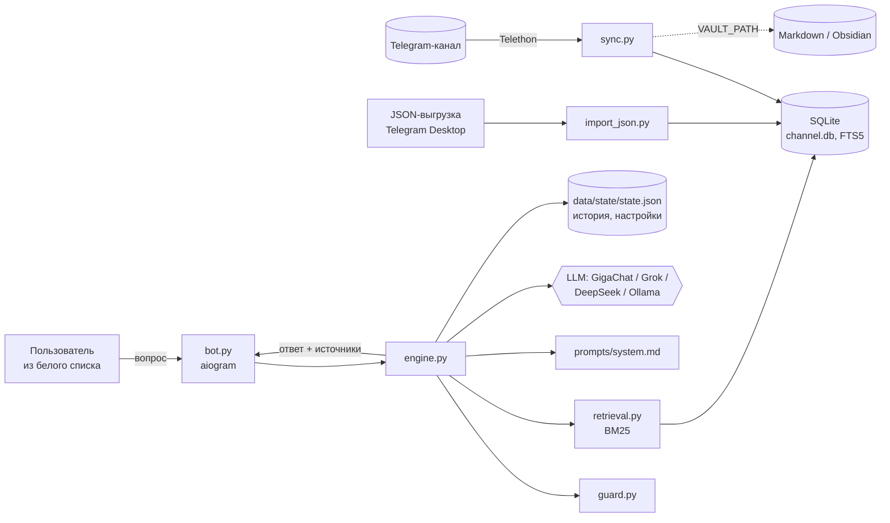

# tg-channel-assistant

Помощник по архиву Telegram-канала: выгружает посты в SQLite (и, по желанию, в Markdown/Obsidian),
ищет по ним и отвечает на вопросы в Telegram-боте через LLM (GigaChat, Grok, DeepSeek или локальная Ollama)
со ссылками на исходные посты. Бот отвечает только пользователям из белого списка.

> **English summary.** A self-hosted assistant for a Telegram channel archive. A Telethon user session
> incrementally syncs a channel into SQLite (FTS5) and optionally a Markdown vault; an aiogram bot answers
> whitelisted users with an LLM (GigaChat / xAI Grok / DeepSeek / Ollama, chosen via `.env`) grounded in
> BM25-retrieved posts, with links to sources. Includes QR login, a configurable system prompt file,
> basic prompt-injection guard, admin commands and Docker setup. Use it only for channels you are
> entitled to process. MIT license.

## Возможности

- Инкрементальная синхронизация канала через Telethon (пользовательская сессия) → `data/channel.db`
  (SQLite, полнотекстовый индекс FTS5).
- Необязательная копия в Markdown: один файл на пост, папки по месяцам (удобно для Obsidian).
- Импорт JSON-выгрузки Telegram Desktop (`python -m app.import_json result.json`).
- Поиск BM25 по постам → ответ LLM с источниками `https://t.me/c/...`.
- Провайдеры LLM через `.env`: `gigachat`, `xai` (Grok), `deepseek`, `ollama`.
- Системный промпт — в файле (`prompts/system.md`), правится без пересборки.
- Белый список пользователей, команды админа, оценки ответов 👍/👎.
- Вход в Telegram по QR-коду, запуск в Docker.

## Архитектура



| Файл | Что делает |
|---|---|
| `app/main.py` | запуск: фоновая синхронизация + бот |
| `app/sync.py`, `app/db.py` | выгрузка канала, SQLite + FTS5 |
| `app/markdown.py`, `app/import_json.py` | Markdown-копия, импорт выгрузки Telegram Desktop |
| `app/retrieval.py` | BM25 по постам |
| `app/engine.py`, `app/prompt.py`, `app/guard.py` | сборка промпта, защита от вытаскивания промпта |
| `app/llm.py` | GigaChat / xAI / DeepSeek / Ollama |
| `app/bot.py`, `app/access.py`, `app/state.py` | бот, белый список, история |
| `app/qrlogin.py`, `app/login.py` | вход в Telegram |

## Установка

1. **Свои ключи Telegram API.** Зайдите на <https://my.telegram.org> → *API development tools*, создайте
   приложение, получите `api_id` и `api_hash`. Не используйте чужие ключи и не публикуйте свои.
2. **Бот.** Создайте бота у [@BotFather](https://t.me/BotFather), получите токен.
3. **Настройки.**
   ```bash
   cp .env.example .env
   # заполните TG_API_ID, TG_API_HASH, TG_CHANNEL, BOT_TOKEN, ALLOWED_USER_IDS / ADMIN_IDS, LLM_PROVIDER и ключ
   cp prompts/system.example.md prompts/system.md   # и отредактируйте под свой канал
   ```
   Свой числовой Telegram id можно узнать, например, у [@userinfobot](https://t.me/userinfobot).
4. **Вход в Telegram (один раз).** Аккаунт должен иметь доступ к каналу.
   ```bash
   docker compose build
   docker compose run --rm bot python -m app.qrlogin   # QR: Telegram → Настройки → Устройства → Подключить устройство
   # или по коду: docker compose run --rm bot python -m app.login
   ```
   Сессия сохранится в `data/user.session` — это доступ к вашему аккаунту, храните как пароль.
5. **Запуск.**
   ```bash
   docker compose up -d
   docker compose logs -f
   ```

Без Docker: Python 3.11+, `pip install -r requirements.txt`, затем `python -m app.qrlogin` и `python -m app.main`.

### LLM

| `LLM_PROVIDER` | Что нужно |
|---|---|
| `ollama` | локальная [Ollama](https://ollama.com), `OLLAMA_URL`, `OLLAMA_MODEL`. Из Docker: `OLLAMA_URL=http://host.docker.internal:11434` |
| `gigachat` | `GIGACHAT_AUTH_KEY` (ключ авторизации из [Studio](https://developers.sber.ru/studio)). Корневой сертификат Минцифры лежит в `certs/` |
| `xai` | `XAI_API_KEY`, `XAI_MODEL` |
| `deepseek` | `DEEPSEEK_API_KEY`, `DEEPSEEK_MODEL` |

### Тесты

```bash
pip install -r requirements-dev.txt
pytest -q
```

## Команды бота

Пользователи:

| Команда | |
|---|---|
| любой текст | вопрос по архиву |
| `/short` `/mid` `/long` | длина ответов |
| `/again` | ответить на последний вопрос заново |
| `/forget` | забыть историю диалога |
| `/help` | справка |

Админы (`ADMIN_IDS`):

| Команда | |
|---|---|
| `/add <id>` / `/remove <id>` | выдать / снять доступ (хранится в `data/state/state.json`) |
| `/users` | кто имеет доступ |
| `/status` | модель, канал, размер базы |
| `/stats` | число вопросов и оценок |

Сообщения от пользователей не из белого списка бот молча игнорирует.

## Приватность и ответственность

- Используйте проект только для каналов, которые вы вправе обрабатывать (свой канал или с разрешения
  владельца). Соблюдайте [условия Telegram API](https://core.telegram.org/api/terms) и законы о персональных данных.
- Бот отвечает только пользователям из белого списка; не открывайте доступ всем, если не можете
  распространять содержимое канала.
- Архив (`data/`), сессия Telegram (`*.session`) и `.env` хранятся только у вас и исключены из git.
  Вопросы пользователей и найденные выдержки отправляются выбранному LLM-провайдеру — учитывайте это
  при выборе (Ollama работает локально).

## Скриншоты

<!-- Добавьте скриншоты в docs/screenshots/ и вставьте сюда, например:  -->
_Скоро._

## Лицензия

[MIT](LICENSE) © 2026 Ilya Mednikov
